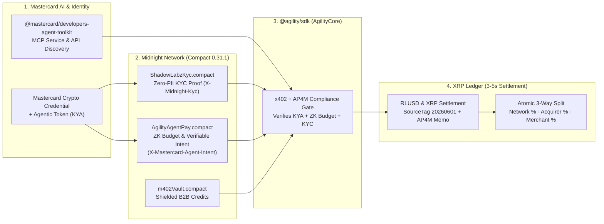

# Pitching `@agility/sdk` to Mastercard at Ripple Swell

**Presenter Guide: Bringing Zero-Knowledge Privacy (Midnight Network) & 3–5s RLUSD/XRP Settlement (`x402-xrpl`) to Mastercard Agent Pay for Machines (AP4M) and `@mastercard/developers-agent-toolkit`.**

---

## 1. The Ultimate Hook: We Built Directly on Mastercard's Newest AI & x402 Stack

Mastercard recently launched three major developer and agentic commerce products:
1. **Mastercard Agent Pay for Machines (AP4M)** *(launched June 2026)* — Built directly on the open **`x402`** protocol with 4 pillars: **Credentialing ("Know Your Agent" + Agentic Tokens)**, **Permissioning (on-chain spending limits & Verifiable Intent)**, **Transacting (`x402`)**, and **Multi-Rail Settlement (Cards, Accounts, and Stablecoins)**.
2. **Mastercard Developers Agent Toolkit (`@mastercard/developers-agent-toolkit` & `@mastercard/developers-mcp`)** — Mastercard's official Model Context Protocol (MCP) server (`https://developer.mcp.mastercard.com`) and `mastercard-best-practices` skill for AI agents.
3. **Mastercard Crypto Credential** — Institutional KYC and compliance attestation across blockchains.

### The Crucial Gap We Solve for Mastercard at Ripple Swell
When Mastercard announced **Agent Pay for Machines (AP4M)** in June 2026, they noted that human-granted agent permissions and budgets are logged on blockchains (initially Polygon, Solana, and Base) so counterparties can verify an agent is acting within its rules.
- **Problem #1 (Corporate Privacy Leak on Transparent Chains):** Logging an enterprise's AI agent permissions, budgets, and vendor categories onto a *transparent* blockchain lets every competitor see how much that company's AI agents are allowed to spend and which APIs/suppliers they are buying from!
- **Problem #2 (Missing XRPL + RLUSD Settlement Rail):** AP4M needs 3–5 second deterministic finality in **RLUSD** and **XRP** on the **XRP Ledger (`x402-xrpl`)** with zero-PII **Mastercard Crypto Credential** verification.

### Your 60-Second Pitch to Mastercard
> *"We built **`@agility/sdk`** using Mastercard's own **`@mastercard/developers-agent-toolkit`** to bring **Mastercard Agent Pay for Machines (AP4M)** and **Crypto Credential** to the **XRP Ledger** and **Midnight Network**.*
>
> *Mastercard AP4M is already built on **x402** and logs agent permissions on-chain. But if an enterprise logs its AI agent budgets and KYC status on a transparent chain, competitors can read its entire AI spending strategy.*
>
> *With **`@agility/sdk`** and our **`AgilityAgentPay.compact`** contract on Midnight, we make all four pillars of Mastercard Agent Pay for Machines **Zero-Knowledge and XRPL-Native**:*
> 1. ***Know Your Agent (Credentialing):*** *Binds a Mastercard Agentic Token to a Midnight ZK KYC commitment (`ShadowLabzKyc.compact`).*
> 2. ***Zero-Knowledge Permissioning & Verifiable Intent:*** *Proves an AI agent's `x402` request is within its human-approved spending cap and category **without revealing the company's total budget on-chain**.*
> 3. ***3–5s Settlement on XRPL (`RLUSD` & `XRP`):*** *Settles over `x402-xrpl` with atomic network/acquirer/merchant fee splitting, or completely anonymously via Midnight `m402` shielded credits."*

---

## 2. How `@agility/sdk` Integrates Every Mastercard Tool You Shared

| Mastercard Tool / Product | Integrated In This Repo | What It Does Live in `@agility/sdk` |
| :--- | :--- | :--- |
| **`@mastercard/developers-agent-toolkit`** (`v0.1.6`) | `sdk/src/index.ts` (`agility.mastercardToolkit`) + `.devin/mcp_config.json` (`https://developer.mcp.mastercard.com`) + `.devin/skills/mastercard-best-practices/SKILL.md` | Embeds Mastercard's official MCP server and 9 API discovery/OAuth/Open Finance tools directly into the SDK and agent workspace. |
| **Mastercard Agent Pay for Machines (AP4M)** | `contracts/src/AgilityAgentPay.compact` + `agility.agentPay` (`sdk/src/index.ts`) + `.devin/skills/mastercard-agent-pay/SKILL.md` | Implements AP4M's **Know Your Agent (KYA)**, **Agentic Tokens**, and **Verifiable Intent / Spending Limits** in Zero Knowledge on Midnight (`X-Mastercard-Agent-Intent`). |
| **Mastercard Crypto Credential** | `contracts/src/ShadowLabzKyc.compact` + `agility.kyc` (`sdk/src/index.ts`) | Acts as the `kycAuthority` issuing blinded `persistentCommit` KYC credentials (`X-Midnight-Kyc`) with zero PII on-chain. |
| **XRPL X402 + RLUSD / XRP Settlement** | `agility.x402` + `agility.settlement` + `xrpl_x402/shadowlabz_merchant.py` | Settles AP4M `x402` transactions in **RLUSD** or **XRP** on the XRP Ledger with automatic 5% network / acquirer / merchant fee splits. |

---

## 3. End-to-End Architecture: Mastercard AP4M + Midnight ZK + XRPL X402

---

## 4. 90-Second Live Demo Walkthrough for Mastercard at Ripple Swell

Open your **Admin Control Room** (`http://127.0.0.1:8787/admin`) and click the **`@agility/sdk · Mastercard Swell Demo`** tab:

1. **Show Official Mastercard Toolkit Integration:**
   - Point out that `@mastercard/developers-agent-toolkit` (`v0.1.6`) and the Mastercard Developers MCP server (`https://developer.mcp.mastercard.com`) are installed and active inside `@agility/sdk`.
2. **Test 1 — Compliant AP4M Agent Payment (`RLUSD` on XRPL):**
   - Agent Requested Spend: **$250 RLUSD** | Human-Approved Private Cap: **$500 RLUSD** | KYC Tier: **Tier 2** | Authority: **`mastercard-crypto-credential`**.
   - Click **"Run Compliant AP4M + X402 Checkout"**:
     - Shows `X-Midnight-Kyc` (Zero-Knowledge KYC nullifier) AND `X-Mastercard-Agent-Intent` (AP4M Verifiable Intent nullifier proving `$250 <= $500` **with `budgetHiddenInZeroKnowledge: true`**).
     - Outputs the ready-to-sign **RLUSD** XRPL `Payment` transaction with the `agility/mc-ap4m-x402` memo and 3-way split.
3. **Test 2 — Block an AI Agent Exceeding Its Human-Granted Budget (`AP4M Permissioning`):**
   - Click **"Simulate AP4M Budget Overrun (403)"** (e.g., Agent tries to spend **$750** when its private cap is **$500**).
   - Shows `AgilityAgentPay.compact` immediately rejecting the transaction (`403 Forbidden — AP4M Permissioning rejected in Midnight ZK circuit`) **without revealing the $500 cap to the merchant or the public blockchain!**
4. **Test 3 — Block a Sanctioned Entity (`Mastercard Crypto Credential`):**
   - Click **"Simulate OFAC / Sanctions Block (403)"** to show `ShadowLabzKyc.compact` stopping the transaction before it ever reaches XRPL.
