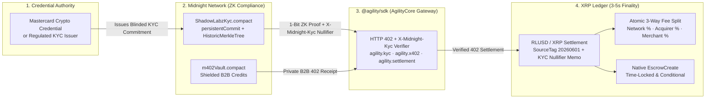

# Pitching `@agility/sdk` to Mastercard at Ripple Swell

**Presenter Guide: Positioning AgilityCore as the Zero-Knowledge Compliance & Agentic Settlement SDK for XRPL (RLUSD / XRP) and Midnight Network.**

---

## 1. The 60-Second Elevator Pitch (For Mastercard Executives at Ripple Swell)

> *"Hi, I'm Stephanie. We started Agility at Ripple's inaugural Real-Life Use Cases Hackathon in 2022 — building both the software and hardware to let merchants accept XRPL payments as easily as a card swipe.*
>
> *What we discovered talking to businesses and enterprises is the exact problem Mastercard is solving with **Crypto Credential** and **Agent Pay**: **institutions want XRPL's 3-second settlement in RLUSD and XRP, and AI agents need HTTP 402 (`x402-xrpl`) to pay for APIs autonomously — but regulated institutions cannot put customer PII on a public blockchain, and they cannot touch unverified wallets.***
>
> *So we built **`@agility/sdk`**. It combines **Midnight Network's Zero-Knowledge KYC** with **XRPL X402 and RLUSD/XRP settlement**. Using our SDK, an authority like **Mastercard Crypto Credential** attests to a user's or AI agent's KYC tier once. Then, on every XRPL payment, our SDK attaches a zero-knowledge compliance proof (`X-Midnight-Kyc`) that proves the payer passed KYC, OFAC sanctions screening, and jurisdiction checks — **while putting zero PII on-chain**. It is already live and powering confidential DAO governance and 3-way revenue splits for **ShadowLabz**."*

---

## 2. How `@agility/sdk` Aligns with Mastercard's 3 Core Initiatives

| Mastercard Initiative | The Gap Today on Public Ledgers | How `@agility/sdk` Solves It |
| :--- | :--- | :--- |
| **1. Mastercard Crypto Credential** | Verifying user/wallet compliance across chains without leaking PII or creating GDPR/CCPA liability on public explorers. | `ShadowLabzKyc.compact` stores only a blinded `persistentCommit<KycCredential>` hash on Midnight. `agility.kyc.proveCompliance()` discloses **only a 1-bit boolean (`true`/`false`)** and a context-scoped nullifier (`X-Midnight-Kyc`) bound to the user's XRPL address. |
| **2. RLUSD & Stablecoin Merchant Settlement** | Merchants and PSPs need automatic fee splitting (Network Fee / Acquirer Fee / Merchant Settlement) and conditional escrow without custom smart contract risk. | `agility.settlement` calculates exact basis-point splits (`500 bps` network / acquirer bps / merchant bps) with zero drop rounding loss and builds native XRPL `Payment` (in **RLUSD** or **XRP**) and `EscrowCreate` transactions. |
| **3. Mastercard "Agent Pay" (Agentic Commerce)** | AI agents need to pay for APIs and commerce over HTTP (`402 Payment Required`), but enterprises need proof that an AI agent is backed by a KYC-verified, non-sanctioned company and bounded by spending policies. | `agility.x402` + **Open Wallet Standard (`OWS`)** + `agility.m402`: Every HTTP 402 request carries `X-Midnight-Kyc` (proving the agent's corporate KYC tier) and settles either deterministically on XRPL (`x402-xrpl`) or with complete B2B sender unlinkability via Midnight shielded credits (`m402Vault.compact`). |

---

## 3. End-to-End Architecture Diagram

---

## 4. 90-Second Live Demo Script (Using Your Admin Control Room at `http://127.0.0.1:8787`)

You can run this entire live demo from your laptop or tablet in the **Admin Control Room** (`http://127.0.0.1:8787/admin`):

1. **Click the `@agility/sdk · Mastercard Swell Demo` tab in the top navigation bar:**
   - Point out the **10-line `@agility/sdk` initialization snippet** configured with `kycAuthorityId: "mastercard-crypto-credential"` and `defaultAsset: "RLUSD"`.
2. **Run Scenario A — Compliant RLUSD / XRP Checkout (`Tier 2 · USA · OFAC Clear`):**
   - Click **"Run Compliant Checkout (`@agility/sdk`)"**.
   - Show the output:
     - Midnight `ShadowLabzKyc.compact` verifies the credential commitment and outputs the `X-Midnight-Kyc` nullifier + XRPL wallet binding hash (`zero PII exposed`).
     - `@agility/sdk` constructs the **RLUSD** (and **XRP**) XRPL `Payment` transaction stamped with `SourceTag: 20260601` and the hex-encoded `agility/zk-kyc-x402` memo, plus the 3-way split breakdown.
3. **Run Scenario B — Blocked Sanctions / Insufficient KYC Tier Attempt:**
   - Toggle **"Simulate Sanctioned / Restricted Jurisdiction"** and click test.
   - Show that the Midnight ZK circuit immediately rejects the proof (`403 Forbidden — Blocked by OFAC / Sanctions screening inside Midnight ZK circuit`) **before** any XRPL transaction or 402 payment can occur.
4. **Show the Live Production Integration (`ShadowLabz`):**
   - Switch to the **DAOs, Splits & Escrows** and **X402 Revenue Ledger** tabs to show how ShadowLabz uses this exact SDK for DAO subscriptions, 3-way revenue splits, and 2-week crowdfunding escrows.

---

## 5. Anticipated Questions from Mastercard (and Your Answers)

### Q1: *"How does this work with Mastercard Crypto Credential?"*
- **Answer:** "Mastercard Crypto Credential already verifies user and VASP compliance off-chain. With `@agility/sdk`, Mastercard acts as the `kycAuthority` on our Midnight contract (`ShadowLabzKyc.compact`). When Mastercard verifies a user, you write a 32-byte blinded commitment (`persistentCommit`) to Midnight. From that point on, the user or their AI agent can prove to any XRPL merchant or X402 API that they hold a valid Mastercard Crypto Credential at Tier 1, 2, or 3 — without Mastercard or the user ever exposing raw PII on the XRP Ledger."

### Q2: *"What happens if a user later fails sanctions screening or their credential is revoked?"*
- **Answer:** "`ShadowLabzKyc.compact` maintains an on-chain `revokedUsers: Set<Bytes<32>>` ledger controlled by the `kycAuthority`. The moment an authority calls `revokeKycUser(userPkHash)`, both `verifySelectiveKycForXrpPayment` and the `@agility/sdk` 402 gateway reject any future proof from that user in real time — as shown in our Admin Control Room."

### Q3: *"Why use both Midnight and XRPL instead of just one chain?"*
- **Answer:** "Each chain does what it was purpose-built for: **XRPL** provides 3–5 second deterministic finality, deep liquidity, native `RLUSD` stablecoin settlement, native `EscrowCreate`, and T54's `x402-xrpl` facilitator ecosystem. **Midnight** provides programmable zero-knowledge data protection (`Compact`) and shielded credits (`m402`). `@agility/sdk` abstracts both behind one clean TypeScript/Python interface so developers don't have to be cryptographers to build compliant payments."
