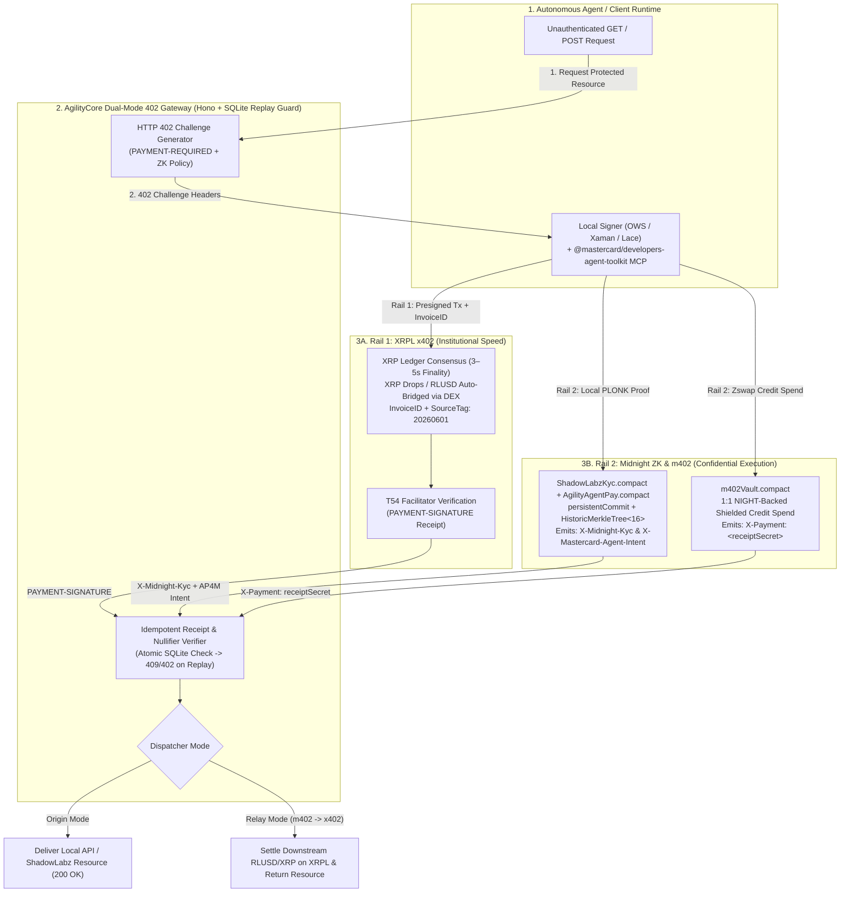

# This-is-Swell — `@agility/sdk` & AgilityCore Execution Layer
### Architectural Foundations of Private Agentic Commerce: Integrating XRPL `x402`, Midnight Zero-Knowledge Compliance, and Mastercard Agent Pay for Machines (`AP4M`)

[-7c5cff)](./contracts/src/)
[](./contracts/package.json)
[](./xrpl_x402/)
[](./sdk/src/index.ts)

---

## 1. Introduction & Macro Dynamics of Machine-to-Machine Economies

Conceived at **Ripple's Inaugural "Real-Life Use Cases" Hackathon (2022)** — where the Agility team engineered both an XRPL merchant payment application and a companion POS hardware device with the **XRdoge** decentralized community — **AgilityCore (`@agility/sdk`)** was built to solve the structural bottleneck of autonomous machine-to-machine (M2M) and institutional Web3 commerce.

The rapid evolution of autonomous software agents executing programmatic API calls, data retrieval pipelines, and multi-step financial workflows has exposed fundamental limitations in legacy payment infrastructures:
- **Web2 Friction & Credential Fragility:** Static API keys stored in agent memory face key rot and exfiltration risk; traditional card rails lack granular per-request authorization mechanics; and multi-day clearinghouse settlement prevents real-time micro-transactional invocation.
- **The Public Ledger Privacy-Compliance Paradox:** While public blockchains resolve settlement latency, standard transparent ledgers broadcast every agent's on-chain address, token balance, invocation frequency, and vendor interaction graph to block explorers and commercial competitors. Concurrently, operators of regulated endpoints (e.g., financial data feeds, enterprise DAOs like **ShadowLabz**, and **Mastercard** merchant networks) cannot legally deliver resources without verifying counterparty compliance across **Know-Your-Customer (KYC)**, **Know-Your-Agent (KYA)**, **AML**, and **OFAC jurisdictional sanctions screenings**.

**`This-is-Swell` (`@agility/sdk`)** resolves this dual imperative by merging **HTTP-native `402 Payment Required` machine payments** with **Zero-Knowledge (ZK) cryptography** across two complementary rails:
1. **Rail 1 — XRPL `x402` (`x402-xrpl`):** 3–5 second deterministic finality on the XRP Ledger in native **XRP (drops)** or **RLUSD** stablecoins, with native DEX auto-bridging, XLS-70/XLS-80 KYA & Permissioned Domains, and atomic 3-way basis-point revenue splits.
2. **Rail 2 — Midnight `m402` & ZK Compliance (`Compact 0.31.1`):** Shielded Zswap credit execution (`m402Vault.compact`), Zero-Knowledge KYC selective disclosure (`ShadowLabzKyc.compact`), and **Mastercard Agent Pay for Machines (AP4M)** private budget/intent verification (`AgilityAgentPay.compact`).

---

## 2. The Dual HTTP 402 Architecture: XRPL `x402` and Midnight `m402`

Rather than managing stateful sessions or static API keys, `AgilityCore` revitalizes the **HTTP `402 Payment Required`** status code into a deterministic four-step programmatic loop:



### Dual-Rail Architectural Comparison

| Architectural Attribute | Rail 1: XRPL `x402` (`x402-xrpl`) | Rail 2: Midnight `m402` (`m402Vault.compact`) |
| :--- | :--- | :--- |
| **Settlement Asset** | Native **XRP** (drops) or **RLUSD** (`524C555344...`) issued stablecoins | **NIGHT** tokens pooled 1:1 into Zswap Shielded Credit UTXOs |
| **Settlement Speed & Finality** | **3–5 second** deterministic finality on XRPL consensus ledger (~2s via facilitator) | Zero-knowledge shielded pool settlement on Midnight (`~3.4ms` proof verification) |
| **Identity & Visibility** | Transparent on-chain account address, `SourceTag`, and explicit `InvoiceID` | **Zero-identity payer decoupling** via `receiptSecret` and PLONK proofs |
| **Protocol Handshake** | `HTTP 402` `PAYMENT-REQUIRED` header / `PAYMENT-SIGNATURE` (`X-PAYMENT`) retry | `HTTP 402` challenge with `X-Payment: <receiptSecret>` + `X-Midnight-Kyc` |
| **On-Chain Identity Mechanics** | Native **XLS-70 / XLS-80 KYA** & Permissioned Domains | **Anonymous Merkle Membership** (`HistoricMerkleTree<16, Bytes<32>>`) & Nullifiers |
| **Native FX / Cross-Currency** | Built-in **XRPL DEX / AMM Pathfinder** auto-bridges XRP $\rightarrow$ RLUSD atomically | Relayed via `AgilityCore` Relay Mode into XRPL RLUSD/XRP or EVM USDC |
| **Optimal Application Context** | High-throughput SaaS, DAO treasury splits, & auditable RLUSD/XRP settlement | Confidential B2B agent interactions, proprietary telemetry, & private APIs |

---

## 3. Zero-Knowledge Compliance & Cryptographic Identity Gating

High-value commercial and institutional endpoints cannot operate as un-permissioned payment gates if doing so risks transacting with OFAC-sanctioned entities or unauthorized AI agents. `This-is-Swell` enforces compliance in zero knowledge before any payment settles.

### 3.1 The 5-Step Midnight ZK-KYC Circuit Architecture (`ShadowLabzKyc.compact`)
1. **Attestation Issuance:** An accredited identity authority (e.g., **Mastercard Crypto Credential** or **ShadowLabz KYC Authority**) validates the operator's legal standing, jurisdiction, and KYC tier off-chain.
2. **Persistent Commitment Generation:** The agent stores the raw credential locally as a private witness preimage. Using Compact's native `persistentCommit<KycCredential>(cred, salt)`, the circuit binds the credential to a 32-byte CSPRNG blinding factor, clearing witness taint without exposing raw PII on-chain.
3. **Merkle Tree Insertion:** The commitment hash is registered as a leaf node inside an on-chain `HistoricMerkleTree<16, Bytes<32>>` (`kycMembers`, capacity 65,536 members per tree) so historical proofs remain valid as new members join.
4. **Off-Chain Proof Generation:** Prior to invoking a protected endpoint, the runtime executes `verifySelectiveKycForXrpPayment` or `authorizeAnonymousDaoAction`, asserting:
   - `assert(path.leaf == leaf)` (binds the Merkle path to the caller's secret key to prevent leaf-substitution attacks)
   - `assert(kycMembers.checkRoot(disclose(merkleTreePathRoot<16, Bytes<32>>(path))))`
   - `!cred.isSanctioned && cred.tier >= minTier && cred.jurisdictionCode != blockedJurisdiction`
5. **Transcript Verification:** The circuit emits **only a single boolean verdict (`true`/`false`)** and a single-use **Payment Nullifier** to the public transcript.

### 3.2 Replay Nullification & Compact Vault Security Invariants

To prevent proof interception, front-running, or token forgery across HTTP retries, the contracts enforce three cryptographic invariants:

1. **Deterministic Replay Nullifier (`ShadowLabzKyc.compact` & `AgilityAgentPay.compact`):**
   $$\text{PaymentNullifier} = \text{persistentHash}(\text{DomainSeparator} \parallel \text{SecretKey} \parallel \text{InvoiceOrContextID})$$
   Published nullifiers are inserted into on-chain `Set<Bytes<32>>` registries and the gateway's local SQLite idempotency table. Any replayed proof produces a duplicate nullifier collision and is rejected immediately (`HTTP 409 Conflict` / `402 receipt-already-used`).
2. **Front-Running Resistant Service Binding (`m402Vault.compact`):**
   $$\text{ServiceID} = \text{persistentHash}(\text{pad}(32, \text{"m402:sid:v1"}) \parallel \text{MerchantOwner} \parallel \text{ContextSalt} \parallel \text{ResourcePrice})$$
   Binding both `MerchantOwner` and `ResourcePrice` into `ServiceID` prevents mempool observers from front-running service registrations or substituting a lower price.
3. **Strict Zswap Coin-Color Validation (`m402Vault.compact`):**
   $$\text{ValidatedType} = \text{tokenType}(\text{creditDomain}(), \text{kernel.self}())$$
   Because `receiveShielded(disclose(coin))` does not implicitly constrain token color, `pay()` explicitly asserts `coin.color == tokenType(creditDomain(), kernel.self())` and `coin.value == price as Uint<128>`, defeating counterfeit shielded token injection.

### 3.3 Mastercard Agent Pay for Machines (AP4M) in Zero Knowledge (`AgilityAgentPay.compact`)
Mastercard's **Agent Pay for Machines (AP4M)** is built on `x402` and logs human-granted AI agent permissions on-chain. Logging corporate AI spending limits on transparent chains leaks enterprise budgets to competitors. `AgilityAgentPay.compact` commits `AgentPolicy` (`maxSpendPerTxDrops`, `allowedCategoryCode`, `ownerKycPkHash`) privately on Midnight, emitting `X-Mastercard-Agent-Intent` to prove an AI agent is credentialed (**Know Your Agent**) and within its spending cap (**Verifiable Intent**) with `budgetHiddenInZeroKnowledge: true`.

---

## 4. AgilityCore Dual-Mode Dispatcher & 3-Way Revenue Split Engine

Built in TypeScript on the **Hono** edge framework (`gateway/`) with a companion Python 3.12 **FastAPI `x402-xrpl`** service (`xrpl_x402/`), `AgilityCore` operates in two routing modes:
- **Origin Mode:** Directly gates local APIs and **ShadowLabz (`shadowlabz.io`)** endpoints, verifying `X-Midnight-Kyc`, `X-Mastercard-Agent-Intent`, and XRPL/Midnight payment receipts before releasing resources.
- **Relay Mode:** Accepts a private Midnight `m402` shielded credit receipt on the ingress leg and automatically executes a downstream institutional **RLUSD** or **XRP** settlement on the XRP Ledger via `x402-xrpl`, decoupling buyer privacy from merchant balance-sheet settlement.

### Zero-Rounding-Loss 3-Way Split Invariant (`@swell/shared`)
For **ShadowLabz Paid DAO Memberships** and **Mastercard Acquirer/Merchant Splits**, `computeShadowLabzSplit(totalDrops, organizerFeeBps)` enforces:
$$\text{PlatformDrops} = \left\lfloor\frac{\text{TotalDrops} \times 500}{10000}\right\rfloor, \quad \text{OrganizerDrops} = \left\lfloor\frac{\text{TotalDrops} \times \text{OrganizerBps}}{10000}\right\rfloor$$
$$\text{TreasuryDrops} = \text{TotalDrops} - \text{PlatformDrops} - \text{OrganizerDrops}$$
guaranteeing $\text{PlatformDrops} + \text{OrganizerDrops} + \text{TreasuryDrops} \equiv \text{TotalDrops}$ with zero drop loss.

---

## 5. Empirical Ecosystem Performance & Comparative Protocol Analysis

### 5.1 Ecosystem Benchmarks

| Metric / Parameter | Measured / Target Value |
| :--- | :--- |
| **Active Autonomous Payment Agents (Ecosystem)** | `69,000+` registered active agent entities |
| **Cumulative `x402` Protocol Volume** | `$50,000,000+` USD equivalent |
| **Weekly Ecosystem Transaction Activity** | `500,000+` weekly HTTP 402 payment requests |
| **XRPL On-Ledger Settlement Finality** | **3–5 seconds** deterministic consensus finality (`~2s` via facilitator) |
| **Midnight ZK Proof Verification Latency** | **`~3.4 ms`** on-chain verification (`0.20s` off-chain `pureCircuits` hash check) |
| **XRPL Base & Owner Reserve** | `1 XRP` base reserve (`1,000,000` drops) + `0.2 XRP` per trust line / escrow / offer |

### 5.2 Comparative Analysis of Agentic Payment Protocols

| Protocol Standard | Settlement Layer | Privacy Guarantees | Regulatory & Compliance Features | Primary Constraints |
| :--- | :--- | :--- | :--- | :--- |
| **XRPL `x402` + Midnight ZK (`AgilityCore`)** | **XRP Ledger + Midnight Shielded UTXO** | **Hybrid:** Auditable XRPL or Full ZK Shielding via Midnight `m402` | **Built-in ZK-KYC (`persistentCommit`), AP4M KYA/Intent, XLS-70/80, Native RLUSD** | Requires dual-rail `AgilityCore` gateway |
| **Lightning `L402`** | Bitcoin Lightning Network | Medium: Onion-routed, but vulnerable to channel graph analysis | None native; relies on external off-chain middleware | Inbound/outbound channel liquidity & node uptime constraints |
| **Standard `x402` (EVM / Base)** | Ethereum L2s (`EIP-3009` `transferWithAuthorization`) | Low: Fully transparent on-chain payer/payee addresses & budgets | Limited to address-level blacklisting | Exposes enterprise AI agent spending graphs; L2 sequencer dependencies |
| **Machine Payments Protocol (`MPP`)** | Multi-chain (Tempo, Solana, Stripe) | Low–Medium: Depends on underlying rail | Centralized card/account KYC | Centralized fallback dependencies |

---

## 6. Compiled Smart Contract & Package Inventory

```text
This-is-Swell/
├── contracts/                          # 7 Compiled Midnight Compact 0.31.1 Contracts (language 0.23)
│   ├── src/ShadowLabzKyc.compact       # ZK-KYC persistentCommit, selective disclosure & HistoricMerkleTree<16>
│   ├── src/AgilityAgentPay.compact     # Mastercard AP4M Know-Your-Agent & ZK spending limit circuit
│   ├── src/AgilityPayment.compact      # KYC-to-XRPL wallet binding & settlement receipt registry
│   ├── src/AgilityEscrow.compact       # 2-week DAO crowdfunding pools (blockTimeLt / blockTimeGte)
│   ├── src/ShadowLabzSubscription.compact # Platform tiers & 3-way DAO split configuration (500 bps + orgBps)
│   ├── src/ShadowLabzReputation.compact   # Alias-only governance XP & selective threshold proofs
│   ├── src/m402Vault.compact           # Pooled NIGHT -> 1:1 Zswap shielded credit 402 vault
│   ├── src/pure.ts                     # Re-exports pureCircuits & ledger() for all 7 contracts
│   └── src/managed/                    # Compiler-generated JS/TS runtime & type declarations
├── sdk/                                # @agility/sdk Unified TypeScript SDK
│   └── src/index.ts                    # AgilitySDK: .kyc, .agentPay, .mastercardToolkit, .x402, .settlement, .m402
├── gateway/                            # AgilityCore Hono Gateway, Admin Control Room & Vitest Suite
│   ├── src/app.ts                      # Dual-rail 402, Admin Authority, DAO Split, Escrow & AP4M Playground APIs
│   ├── src/admin-ui.ts                 # Interactive Admin Control Room & Mastercard Swell Demo UI (GET /)
│   ├── src/demo-ui.ts                  # Interactive Member Payer Portal Demo UI (GET /portal)
│   ├── src/kyc-verifier.ts             # Midnight pureCircuits KYC, Nullifier & m402 Receipt Verifier
│   ├── src/xrpl-service.ts             # XRPL Payment, RLUSD, 3-Way Split & EscrowCreate Builder
│   └── src/app.test.ts                 # 6 End-to-End Integration Tests (KYC, AP4M, 402, Splits, Escrow, Admin)
├── xrpl_x402/                          # Python 3.12 Reference x402-xrpl Merchant & Autonomous Payer
│   ├── shadowlabz_merchant.py          # FastAPI server with T54 require_payment + X-Midnight-Kyc check
│   └── shadowlabz_payer_agent.py       # Autonomous x402_requests payer agent
├── shared/                             # @swell/shared types, ShadowLabz plans & computeShadowLabzSplit
├── web/                                # Drop-in Next.js Admin Landing Page (AdminLandingPage.tsx)
└── .devin/
    ├── mcp_config.json                 # Official Mastercard Developers MCP (https://developer.mcp.mastercard.com)
    └── skills/                         # 10 Modular Skills (XRPL, x402, Midnight, m402, Mastercard AP4M & MCP)
```

---

## 7. Quickstart & Reproducible Verification

For full toolchain installation (`Node 24`, `Compact 0.31.1`, `Python 3.12 + uv`, and `Docker Proof Server`), see **[SETUP.md](./SETUP.md)**.

```bash
# 1. Activate Node 24 and install dependencies across all 4 workspaces
nvm use 24
npm install

# 2. Compile all 7 Midnight Compact 0.31.1 smart contracts & build TypeScript packages
npm run compile:skip-zk
npm run build
npm run typecheck

# 3. Run the Vitest integration test suite (verifies all 6 test suites in <1.5s)
npm test

# 4. Launch the Admin Control Room & Mastercard AP4M Playground on http://127.0.0.1:8787
npm run dev:gateway
```

---

## 8. Documentation & References

- **[MASTERCARD_RIPPLE_SWELL_PITCH.md](./MASTERCARD_RIPPLE_SWELL_PITCH.md)** — Executive pitch guide, Mastercard AP4M & Crypto Credential alignment, and 90-second live demo script.
- **[SHADOWLABZ_DEVELOPER_HANDOFF.md](./SHADOWLABZ_DEVELOPER_HANDOFF.md)** — API specification and drop-in React/Next.js hooks (`useAgilityCore`) for `shadowlabz.io`.
- **[SHADOWLABZ_PRIVACY_ARCHITECTURE.md](./SHADOWLABZ_PRIVACY_ARCHITECTURE.md)** — Deep dive into `ShadowLabzKyc.compact` selective disclosure and `HistoricMerkleTree` proofs.
- **[SETUP.md](./SETUP.md)** — Complete environment setup and verification guide.
- **[ABOUT.md](./ABOUT.md)** — Origin story from the 2022 Ripple Hackathon & XRdoge hardware to AgilityCore.
